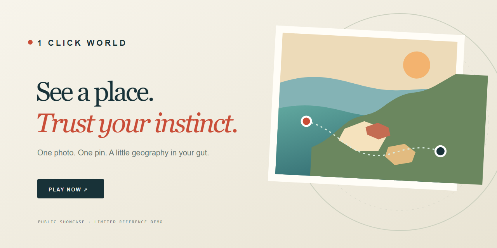
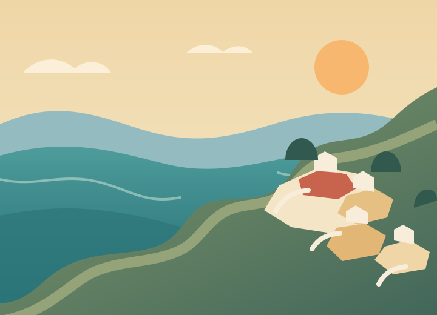
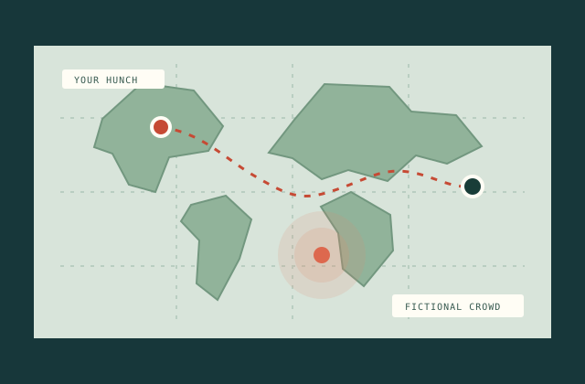
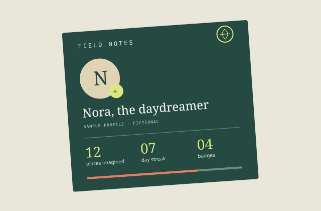
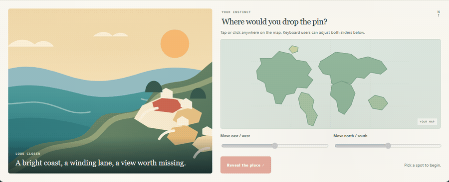

  <h1>1 Click World</h1>
  
<strong>Observa un lugar. Pon un pin. Confía en tu intuición.</strong>

  
<a href="https://one-click-world.vercel.app"><strong>JUGAR AHORA ↗</strong></a>

  
<a href="README.md" lang="en">English</a> · <a href="README.es.md" lang="es">Español</a>

  

> **Galería pública / Implementación de referencia limitada**
>
> 1 Click World es un juego diario de intuición geográfica. Este repositorio es una galería pública del producto y una implementación de referencia limitada, creada desde cero para demostración. No es la publicación del código de producción. El motor real de puntuación, el catálogo de lugares, el backend, el modelo de datos, los sistemas antiabuso, los trabajos operativos, la infraestructura y una parte sustancial de la aplicación activa se han excluido deliberadamente y permanecen privados.

## Cómo se siente

Observa un paisaje. Confía en tu primera impresión. Pon un pin y descubre la respuesta. 1 Click World convierte la geografía en un pequeño ritual diario que puedes compartir con tus amistades o disfrutar a tu ritmo.

## Galería

Todas las imágenes de esta galería son ilustraciones originales creadas para este repositorio. No hay capturas de producción, perfiles reales, imágenes de rondas activas ni coordenadas geográficas reales.

| Un lugar para imaginar | Un pin y la revelación | Un pasaporte para la curiosidad |
| --- | --- | --- |
|  |  |  |

## Diario y modos de juego

| Diario | Sprint | Supervivencia | Quiz de banderas |
| --- | --- | --- | --- |
| Un momento compartido de intuición geográfica. | Respuestas rápidas y ritmo ágil. | Sigue mientras tus instintos te acompañen. | Reconoce un país por sus colores. |

Estos modos describen el producto en vivo. Son avances de galería y no están implementados en esta demo de referencia.

## Por qué es divertido

Cada ronda es una pequeña apuesta por tu intuición: detecta una pista, elige un lugar y compara la revelación con tu primera impresión y una vista ficticia del grupo.

## Comunidad y liga semanal

El juego en vivo convierte las respuestas individuales en un ritmo semanal amistoso. El showcase presenta esa idea con nombres, puestos y valores inventados; no contiene registros de jugadores ni la implementación del ranking.

## Pasaporte y progreso

Las rachas, los logros y los hitos con estilo de pasaporte convierten cada sesión en un viaje. La galería usa únicamente un perfil ficticio y progreso sintético.

## Demo offline segura

Usa el mapa para colocar un pin, descubrir una de tres escenas inventadas y pasar a la siguiente. La demo funciona con HTML, TypeScript y archivos SVG locales. No carga mapas, imágenes, analítica, cuentas, APIs ni datos de producción.

La distancia, la puntuación y el percentil de crowd que aparecen son fixtures de interfaz precalculados. No dependen de tu respuesta y no representan un contrato del motor de puntuación en vivo.

## Muestra de ingeniería

La implementación de referencia usa HTML semántico, un sistema de diseño adaptable, textos en dos idiomas, modelos estrictos de TypeScript, una máquina de estados explícita para la demo, un adaptador de fixtures y pruebas de navegador que bloquean las solicitudes a otros sitios. Su arquitectura se mantiene deliberadamente pequeña:

<pre><code>Jugador
  ↓
Experiencia geográfica web
  ↓
Capa de juego autoritativa en el servidor
  ↓
Contenido y datos protegidos</code></pre>

El juego en vivo valida en el servidor las acciones competitivas. La demo pública de este repositorio está aislada, usa fixtures sintéticos y no se conecta a la API de producción, a la base de datos ni al sistema diario de contenido.

## Qué incluye

- Galería del producto con un enlace directo al juego en vivo.
- Una pequeña demo offline para colocar un pin y descubrir el resultado en tres escenas sintéticas.
- Escenas SVG originales, ilustraciones de mapa y gráfico para compartir.
- Interfaz en inglés y español.
- Modelos tipados, adaptador local de fixtures y transiciones de estado explícitas.
- Diseño adaptable, controles de teclado, foco visible, compatibilidad con movimiento reducido y mensajes de estado accesibles.
- Pruebas unitarias, de interacción en navegador y de aislamiento de red; lint, comprobación de tipos, build, auditoría de dependencias, análisis de secretos y detección de contenido prohibido.
- Workflows mínimos de GitHub Actions con permisos de solo lectura para las comprobaciones.

## Qué permanece privado deliberadamente

- El motor de puntuación de producción y el proceso de selección diaria.
- El catálogo de lugares de producción, el contenido de rondas y sus identificadores.
- Las APIs de producción, el esquema de base de datos, las políticas y la configuración de almacenamiento.
- La implementación de salas privadas.
- Los sistemas anti-cheat y antiabuso y las reglas de equidad competitiva.
- La autenticación, los datos de usuarios, la analítica y las herramientas de administración.
- Las operaciones de contenido, los trabajos, el despliegue y la infraestructura.
- Las credenciales e integraciones de producción.
- Una parte sustancial de la aplicación en vivo y sus funcionalidades.

## Ejecutar en local

Requisitos: Node.js 24 o posterior y npm.

<pre><code>npm ci
npm run dev</code></pre>

Abre la dirección local que muestra Vite. No necesitas un archivo <code>.env</code>, un token de API ni una conexión a servicios.

Ejecuta las mismas comprobaciones que usa CI:

<pre><code>npm run check
npx playwright install chromium
npm run test:e2e
npm audit --omit=dev</code></pre>

La demo no usa dependencias de aplicación en tiempo de ejecución. Las herramientas de desarrollo están declaradas en <code>package.json</code> y fijadas por <code>package-lock.json</code>.

## Seguridad

Este repositorio no se conecta al servicio en vivo. No publiques vulnerabilidades del juego de producción en los issues públicos. Cuando esté habilitado, usa el sistema privado de reporte de vulnerabilidades de GitHub para este repositorio; consulta [SECURITY.md](SECURITY.md).

## Contribuir

Las contribuciones se limitan a la galería, esta demo aislada, accesibilidad, pruebas, traducciones y documentación. Consulta [CONTRIBUTING.md](CONTRIBUTING.md).

## Licencia

Este repositorio es una **galería de código públicamente visible, no una publicación de código abierto**. Copyright © 2026 Iker Pérez. Todos los derechos reservados.

La visualización y las bifurcaciones dentro de GitHub están sujetas a los Términos del Servicio de GitHub. No se concede permiso adicional para reutilizar, redistribuir, desplegar, comercializar, cambiar de marca ni crear productos derivados a partir de este material. Consulta [LICENSE.md](LICENSE.md).

## Créditos

Todas las ilustraciones de la galería y los fixtures de la demo se crearon para este showcase. No hay mapas de terceros ni fotografías de lugares. Consulta [ATTRIBUTION.md](ATTRIBUTION.md) y [NOTICE.md](NOTICE.md).

  <a href="https://one-click-world.vercel.app"><strong>JUGAR AHORA ↗</strong></a>

