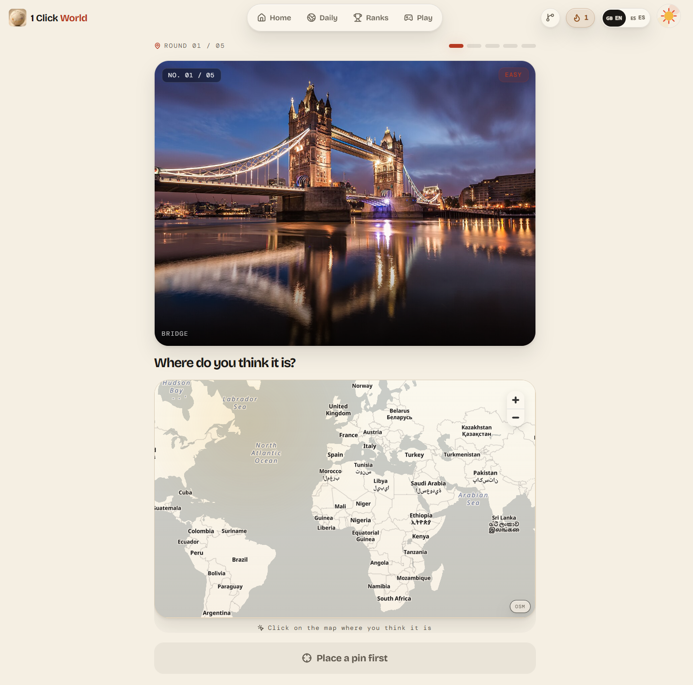
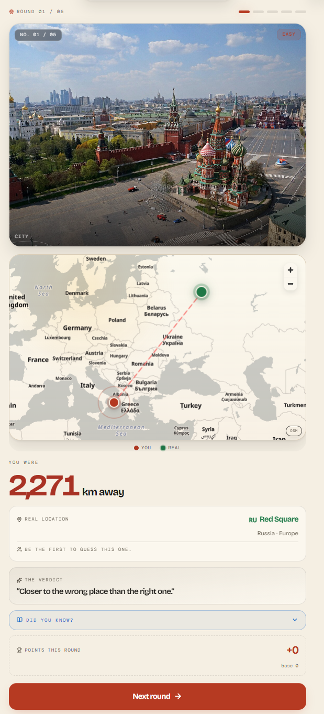
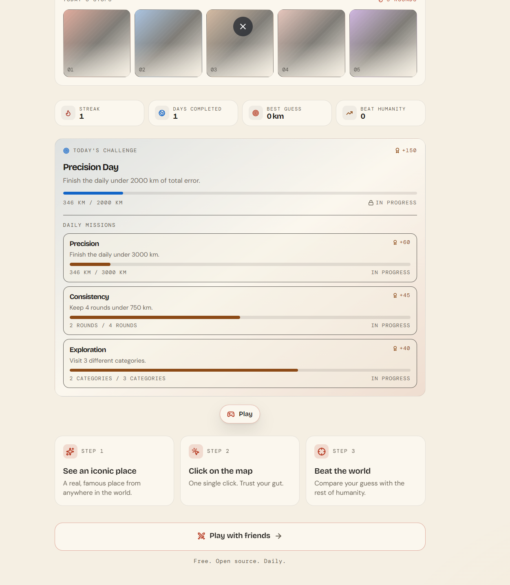
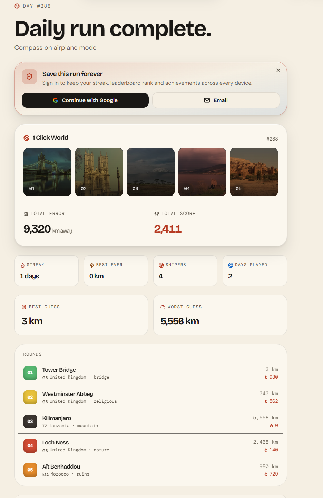
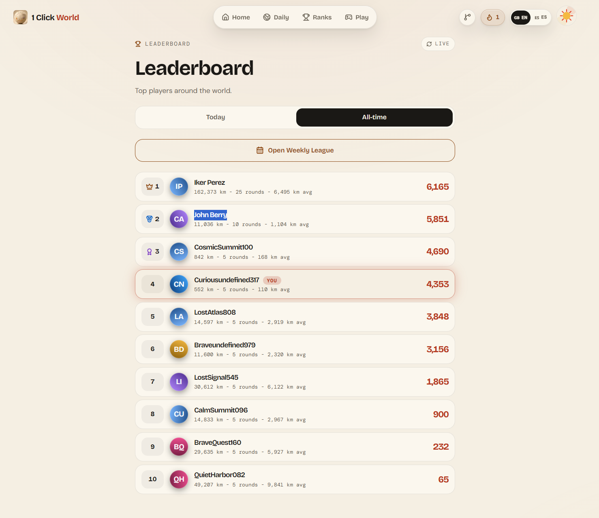
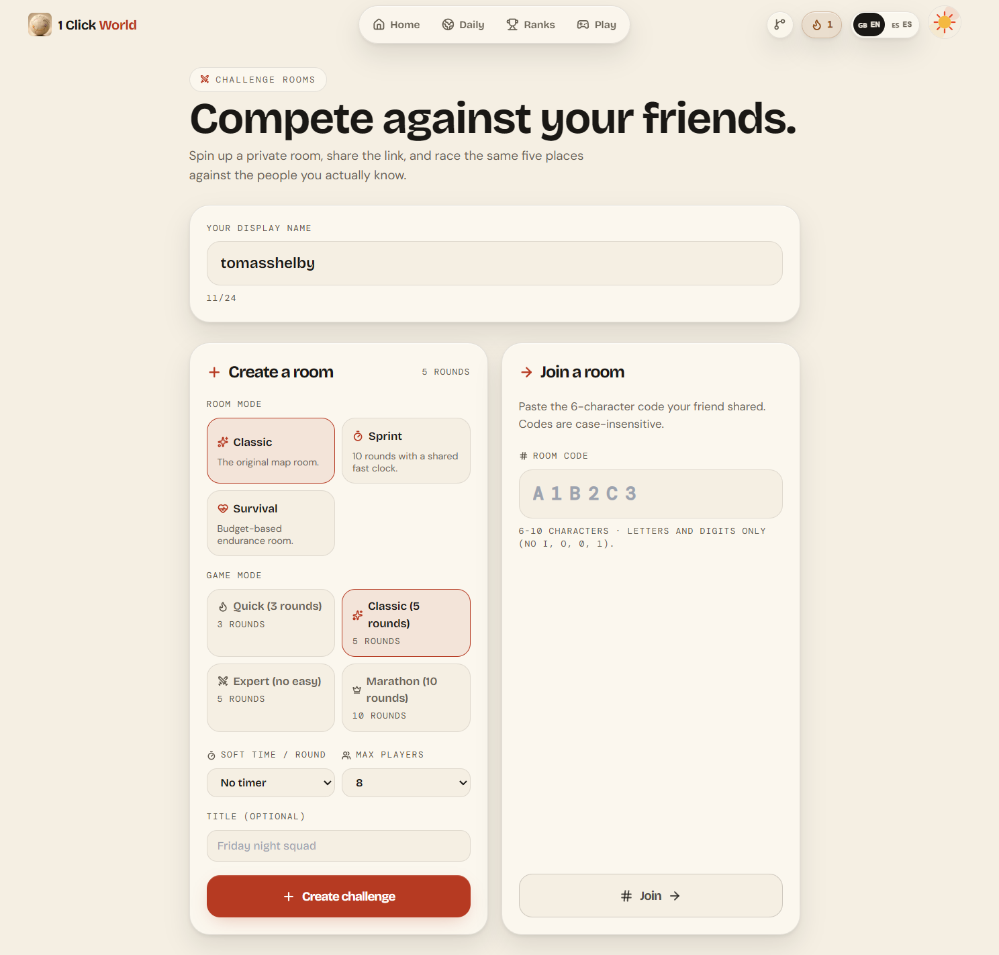

# 1 Click World

> See one real place. Drop one pin on the world map. Find out how close your instinct was.

1 Click World is a free geography game in English and Spanish. Each round shows a real photo of a famous place. You place a single pin on the world map, confirm it, and the game reveals how far you were, where the place really is, and how your run compares with everyone else's.

## Screenshots

| Pin your guess | Reveal on mobile |
| :--- | :--- |
|  |  |
| **Daily overview**: five stops, streak, best guess and today's challenge | **Daily run complete**: total error, score and every round |
|  |  |
| **Play modes**: solo runs or a room with friends | **Challenge rooms**: private rooms with a shared code |
|  |  |

## Gameplay videos

- [Gameplay, part 1](media/videos/gameplay-part-1.mp4)
- [Gameplay, part 2](media/videos/gameplay-part-2.mp4)

## How to play

1. **See an iconic place.** A real photo from anywhere in the world.
2. **Click the map** where you think it is, then confirm. One pin, no second chances.
3. **Beat the world.** The game shows your distance and compares your run with other players.

## Game modes

- **Daily.** Five places that are the same for everyone that day, plus a daily challenge with missions: Precision, Consistency and Exploration.
- **Solo.** Daily, Sprint, Survival and Flags, with global boards.
- **With friends.** Private challenge rooms joined with a six-character code.
  - Room modes: Classic, Sprint (10 rounds on a shared fast clock) and Survival (budget-based endurance).
  - Game lengths: Quick (3 rounds), Classic (5), Expert (5 rounds, no easy places) and Marathon (10).
  - Optional time limit per round, up to 8 players by default.

## Features

- Daily streak, days completed and personal records: best guess, worst guess, best ever and snipers.
- Leaderboards for today, all-time and the Weekly League.
- Optional sign-in with Google or email, to keep your streak and rank across devices. Anonymous play works without an account.
- English and Spanish, switchable from the header.
- Works on phones as well as desktop.

## Built with

Next.js, React, Supabase and MapLibre.

---

Free to play, with a new set of places every day.
